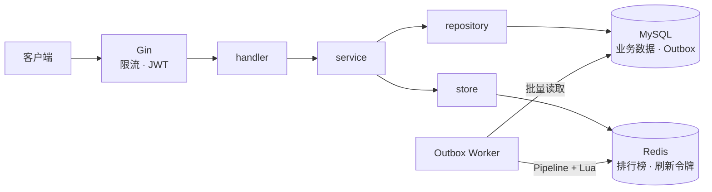

<div align="center">

# Bluebell

**类 Reddit 社区论坛后端：发帖、投票、评论、热度排行**


[性能](#性能) · [架构](#架构) · [快速开始](#快速开始) · [接口文档](./docs/openapi.yaml) · [前端](https://github.com/jasper0507/bluebell_frontend)

</div>

---

- **1000 RPS × 10 分钟零错误**：按业务比例混合 10 个接口，60 万次请求全部成功，总体 p95 45.79ms。
- **用压测驱动优化**：定位并修复 4 个瓶颈，评论列表 p95 从 1618ms 降到 12.6ms，Outbox 积压等待从 72 秒降到 0.075 秒。
- **Outbox 最终一致**：投票、发帖在一个 MySQL 事务里写业务数据和事件，Worker 批量同步到 Redis 排行榜。
- **双令牌认证 + IP 限流**：短期 JWT 加 HttpOnly 刷新令牌、原子轮换；令牌桶按 IP 限流，登录注册单独收紧。

## 性能

服务、k6、MySQL、Redis 同机运行（WSL2，6 逻辑核，3.83 GiB）。混合负载由游客浏览、投票、评论、发帖、登录、注册六类用户流程组成，80% 的帖子访问集中在 20 篇热点帖。

| 接口                   |     流量占比 |                p95 ms |
| ---------------------- | -----------: | --------------------: |
| 评论列表 / 帖子详情    |    28% / 27% |         10.73 / 11.12 |
| 时间列表 / 热榜        |     19% / 6% |           9.05 / 9.43 |
| 投票 / 发表评论 / 发帖 | 6% / 2% / 1% | 29.82 / 28.61 / 31.45 |
| 登录 / 注册            |  4.5% / 0.5% |         70.22 / 90.59 |

1400 RPS 能通过 60 秒短测，但十分钟验证未通过，因此 **1000 RPS 是已验证的稳定下界**。

### 优化历程

首次 1000 RPS 混合压测只成功了 867 RPS，10 个接口 p95 全部超过 500ms。逐个定位后：

| 瓶颈        | 根因                                                                                        | 修复                                                            | 效果                                               |
| ----------- | ------------------------------------------------------------------------------------------- | --------------------------------------------------------------- | -------------------------------------------------- |
| 评论列表    | 两个单列索引被选成 `index_merge`，63 条评论的帖子 COUNT 要扫 2.1 万行，连接池排队放大尾延迟 | 联合索引 `(post_id, deleted_at, created_at)`，合并 COUNT 与查帖 | 1000 RPS 下 p95 **1618 → 12.6ms**（三轮 A/B）      |
| Outbox 积压 | 删除已处理事件时优化器按成本放弃主键，扫到投票事务新插入的行并等锁，单次 DELETE 最长 57 秒  | `DELETE /*+ INDEX(outbox_events PRIMARY) */`                    | 200 RPS 投票最老等待 **72 → 0.075 秒**（三轮 A/B） |
| 帖子详情    | 帖子、作者、社区、票数串行 4 次查询                                                         | 合并为 JOIN，4 → 2 次                                           | 2000 RPS p95 **1433 → 4.9ms**                      |
| 时间列表    | 3 次批量查询                                                                                | 合并为 1 次 JOIN                                                | 2500 RPS p95 **1661 → 127ms**                      |

剩余瓶颈：bcrypt 推断约占服务 CPU 的 80%。以上是同机、小数据集的结果，不代表生产容量。完整数据、失败轮次和诊断过程见[压测发现](./tests/load/findings.md)。

## 架构



- **数据分工**：帖子、投票、评论以 MySQL 为准；Redis 存排行榜投影和刷新令牌哈希。列表先从 Redis 取当前页 ID，再批量回查 MySQL。
- **异步同步**：Worker 每批取 256 条事件，合并同帖事件，Redis 失败的帖子按退避重试。详情票数直接查 MySQL，不受同步延迟影响。
- **热度算法**（借鉴 Reddit）：`hot = sign(net) × log10(max(|net|, 1)) + (created_at − epoch) / 45000`，`net` 为赞成减反对。
- **令牌**：access token 15 分钟；refresh token 7 天，轮换后沿用剩余有效期，不会无限续期。

## 快速开始

需要 Go 1.27.2+ 和 Docker。

```bash
git clone https://github.com/jasper0507/bluebell.git && cd bluebell
make up                                              # 启动 MySQL 和 Redis
cp configs/config.example.yaml configs/config.yaml
make migrate                                         # 建表（MySQL 首次启动需等十几秒）

# 社区没有创建接口，直接写库
docker compose exec -T mysql mysql -uapp -papp_password bluebell -e "
INSERT INTO communities (name, introduction, created_at, updated_at) VALUES
  ('Go', 'Go 语言开发交流', NOW(), NOW());"

make run
curl http://localhost:8080/api/v1/communities
```

配置项可用环境变量覆盖：加 `BLUEBELL_` 前缀、`.` 换成 `_`，如 `BLUEBELL_AUTH_SECRET`。非本地环境务必替换 `auth.secret`。

## 已知限制

- 没有 CORS 中间件；`/health` 不检查依赖；限流计数在进程内，多实例各算各的。

## 许可证

[MIT](./LICENSE)
